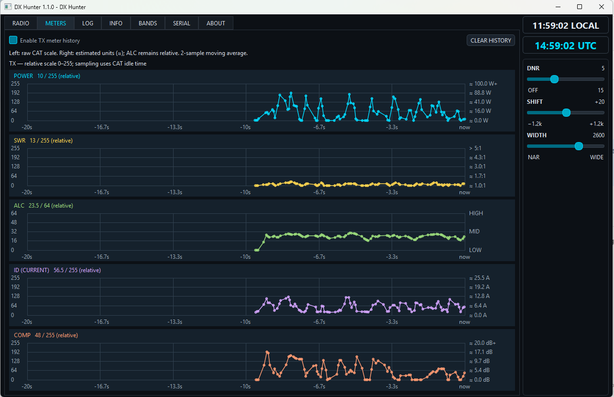

# DX Hunter — Yaesu FTdx10

CAT control and DX tracking for the Yaesu FTdx10.

Visit the **[project website](https://dx-hunter-private.nilton-proton.chatgpt.site)** for downloads, screenshots, features, demonstration video, release history, and instructions.

## TX meter history — November 2, 2026 update

The **METERS** tab, immediately after RADIO, displays 20-second histories for **POWER, SWR, ALC, ID (current), and COMP (compression)**. A two-reading moving average smooths each trace. Sampling runs only while the tab is open and enabled, with normal radio controls prioritized.

Right-hand W, SWR, A and dB scales are **reference estimates**, not factory calibration. ALC remains relative, using a raw 0–64 reference. Compare the indications with your radio.

The window opens at up to **1280 × 800**, adapting to the available display area.

When upgrading, replace `dx-hunter.exe` and keep your existing settings and QSO recovery JSON files beside it.
